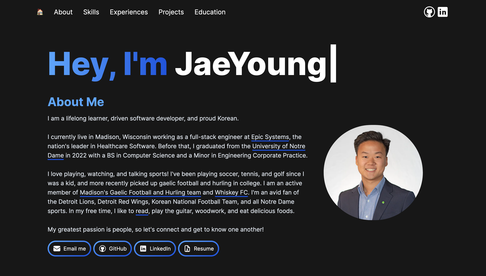

# Portfolio Website

Hi 👋 This is my personal [portfolio](https://jaeyoungchang.vercel.app), built with Next.js and Tailwind CSS and deployed on Vercel.



If you would like to look at my old website to see how it compares, check it out with [this link](https://jaeyoungchang-portfolio.netlify.app/). The website code lives in the [backupHTMLCSS branch](https://github.com/jaeyoungchang5/portfolio/tree/backupHTMLCSS).

## Getting started

```bash
npm install
npm run dev     # http://localhost:3000
```

| Script                 | What it does                               |
| ---------------------- | ------------------------------------------ |
| `npm run dev`          | Local dev server with hot reload           |
| `npm run build`        | Production build (also type-checks)        |
| `npm run lint`         | ESLint                                     |
| `npm run format`       | Prettier, including Tailwind class sorting |
| `npm run format:check` | Fails if any file isn't formatted          |

## Project structure

```
src/
  content/          All site text and data. Most edits happen here.
  components/
    layout/         SiteHeader (sticky nav) and SiteFooter
    sections/       One file per page section: Hero, Experience, Projects, Skills, About
    ui/             Small shared pieces: Section, ButtonLink, Anchor, Details, RichText, ...
  app/
    page.tsx        Puts the sections in order
    layout.tsx      Fonts and page metadata
    globals.css     Base styles and the few shared CSS classes
tailwind.config.ts  Font sizes, spacing, and color names (design tokens)
next.config.mjs     Security headers
public/             Images and skill icons
```

## Editing content

Everything shown on the site comes from `src/content/`. Types in `src/content/types.ts` describe each field, so the editor and the build catch mistakes.

| To change...                               | Edit                                                                                |
| ------------------------------------------ | ----------------------------------------------------------------------------------- |
| Headline, intro, About text, contact links | `profile.ts`                                                                        |
| A job or role                              | `experience.ts` (`featured: true` gives it a full entry; others go under "Earlier") |
| A project                                  | `projects.ts` (order in the file is order on the page)                              |
| Skills and their filter categories         | `tech.ts` (add the icon file to `public/icons/`)                                    |
| Hobbies                                    | `profile.ts` → `hobbies`                                                            |
| Education                                  | `education.ts`                                                                      |

Text fields support two bits of markup: `[label](https://link)` for links and `_text_` for emphasis. Nothing else is interpreted, and no raw HTML is rendered.

## Changing the look

- Font sizes, section spacing, and page width are named tokens in `tailwind.config.ts`. Change them there.
- Colors have a light and a dark value, set as CSS variables at the top of `globals.css`. The Tailwind color names (`bg-paper`, `text-ink`, ...) point at them.
- Dark mode: the site follows the visitor's system setting until they use the switch in the header, which remembers their choice. A skill icon that's hard to see on the dark background takes `onDark: 'invert'` (single-color icons) or `'brighten'` (dark brand colors) in `tech.ts`.
- Styling otherwise lives on each component as Tailwind classes. `globals.css` only holds base styles and two shared classes (`.text-link`, `.eyebrow`).
- The sticky header's height is mirrored in `--header-height` in `globals.css` so in-page links don't land under it. Update both together.
- New page section: create it in `components/sections/`, wrap it in `<Section id title>`, add it to `app/page.tsx`, and add its `id` to the nav list in `SiteHeader.tsx`.
